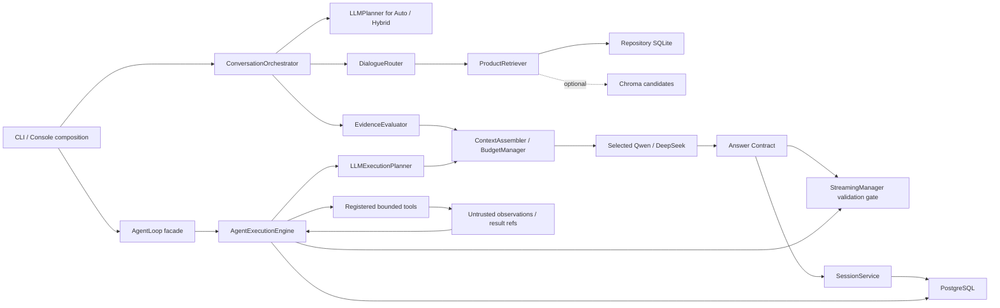
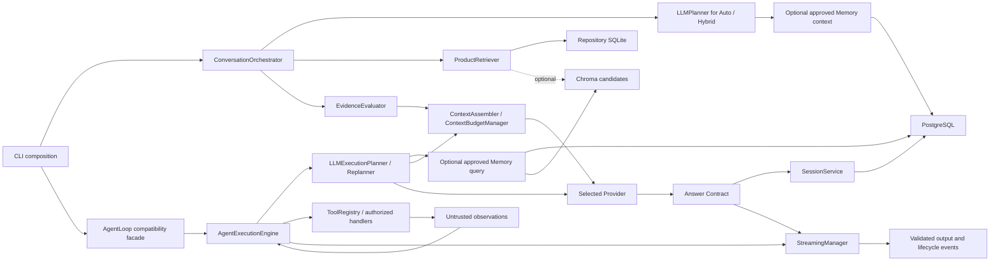
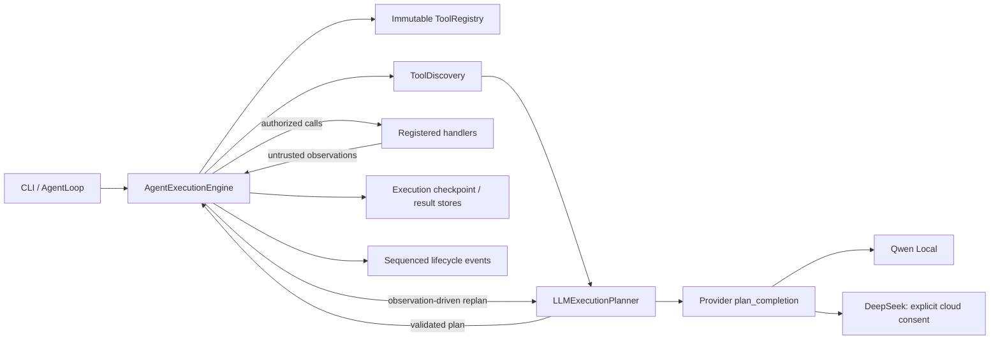
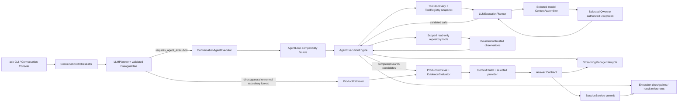
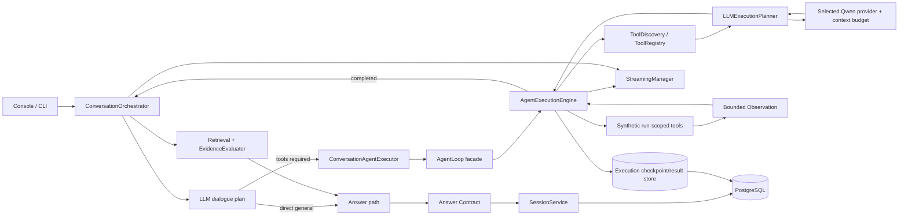

# AgentForge Architecture

## DeepSeek Agent v0.1 release profile (2026-11-09)

New interactive sessions select DeepSeek Flash only after explicit per-session cloud-data consent. The user may choose local Qwen when its credential and service are configured; existing sessions retain their persisted model binding. No provider fallback is silent. This worktree is a **RELEASE_CANDIDATE** within the documented v0.1 scope: targeted real DeepSeek multi-turn acceptance passed after bounded invalid-JSON correction. The full matrix is not claimed as passed; see the release report for remaining exclusions and the unmeasured interactive-launch smoke. See `RELEASE_V0.1_LIMITATIONS.md` for supported and deferred behavior.
The `feature/1.1-core` branch adds development-only multi-repository indexing, bounded history summarization, and cross-file evidence improvements. Published MVP 1.0 remains frozen on `main`/`v1.0.0-mvp` until these changes are separately reviewed and released.

## Tool discovery and output budget boundaries (2026-11-08)

```text
ToolRegistry ──catalog/schema batches + revision cache──> LLMExecutionPlanner
      │                                                     │
      └──────────── schemas ──> PlanValidator <── plan ─────┘
                                      │ validated plan
                                      v
                             AgentExecutionEngine
                         schedule / execute / observe / replan

CLI or Conversation ──budget mode──> ContextBudgetManager
                                           │ selected model descriptor
                                           v
                               provider request + HTTP limits
```

`ToolRegistry` owns tool registration, discovery, detailed schemas, bounded batch retrieval, and schema cache invalidation when the registered tool revision changes. `LLMExecutionPlanner` chooses tools, parameters, and dependencies; `PlanValidator` rejects unknown tools and invalid arguments; `AgentExecutionEngine` owns execution and observation. Discovery rounds are separately bounded and do not consume execution or replanning steps.

`ContextBudgetManager` resolves `concise`, `standard`, `long`, or `max` against the selected model's verified capability and provider/adapter/context limits. CLI `--output-budget` and console `/output-budget` select a request mode; they do not implement a second model cap. The ordinary default is `standard` (16,384 requested tokens), while current Qwen local configuration is clamped to its 512-token adapter ceiling. DeepSeek test descriptors resolve standard=16,384 and long=65,536; `max` uses only a fresh verified model ceiling. Current cached DeepSeek metadata is stale, so those values are deterministic budget-test outcomes, not current live capability claims. Planner output budgets remain independent.

DeepSeek HTTP request/response byte protections scale with the already-resolved input/output budget and stop at a 64,000,000-byte hard safety bound. Oversized responses fail explicitly; `finish_reason=length` is rejected as incomplete. Thinking and visible completion share the provider's `max_tokens` unless the service reports a separate reasoning usage field; reported reasoning usage is recorded separately, not granted an invented extra allowance. Full test/coverage evidence is recorded in `AF042_TOOL_DISCOVERY_OUTPUT_BUDGET_REPORT_20261108.md`.

## Runtime components

```text
Windows launcher / CLI
        │
        ├── Python orchestration
        │     ├── bounded repository scanner and safe file reader
        │     ├── chunker, Python AST parser, SQLite indexer
        │     ├── intent router and lexical/symbol/static-relation retrieval
        │     ├── optional Chroma candidate retrieval
        │     ├── evidence/context builder and Answer Contract
        │     └── conversation and approval workflows
        │
        ├── Local PostgreSQL: conversation and approved-memory authority
        ├── Local Chroma: rebuildable code/memory vector candidates
        ├── Local llama-server: Qwen chat and embedding endpoints
        └── Explicit DeepSeek HTTPS provider: optional cloud chat, no automatic fallback
```

The standard-library CLI and SQLite code-index path can run without a model. Persistent conversations and memory require the optional persistence dependencies and a local PostgreSQL service. Semantic retrieval requires Chroma, the configured local embedding model, and an available embedding service. Chat generation requires an explicitly selected provider.

The current development worktree uses `ConversationOrchestrator` as the application use case for a turn. `cli.py` remains the composition root: it parses commands and constructs repository, session, memory, model, and persistence dependencies. The Orchestrator runs the selected mode, coordinates retrieval and evidence gates, calls a provider, validates the returned text through the Answer Contract, then persists the turn. It returns a structured result rather than printing it. See `AGENTFORGE_PHASE2_FINAL_INTEGRATION_REPORT_20261106.md` for the latest graph, boundaries, and measured limits; the earlier design file is a historical planning snapshot.

`conversation_orchestrator.py` is the application entry for General, Repository, Hybrid, and Auto turns. Fixed General/Repository modes produce explicit plans; Auto/Hybrid use the selected model's bounded, schema-validated `LLMPlanner`, followed by plan validation and `DialogueRouter`. `evidence_evaluator.py` evaluates route confidence and required source-role completeness. It does not semantically prove relevance or entailment. Providers receive mode-specific prompts through provider-neutral `providers/dialogue_protocol.py`, make the model request, and reject malformed, empty, truncated, or unsupported protocol responses. They return untrusted answer text without deciding which evidence IDs are valid. The Orchestrator's Answer Contract validates request-local IDs, paths, lines, response structure, and required cited roles. A valid citation does not establish that the surrounding natural-language claim is true.

On the `feature/1.1-core` development branch, `model_registry.py` holds local model metadata and explicitly refreshed DeepSeek capability metadata. Registry entries describe model capabilities; health checks describe connectivity. Session records persist provider, model, Thinking/effort settings, and cloud-data consent. New interactive sessions default to DeepSeek Flash after the user confirms the cloud-data notice; the user may explicitly select Qwen Local. Existing sessions are not rebound automatically. There is no silent fallback or automatic cloud routing.

## Retrieval and evidence

`scanner.py` discovers allowed source/document files; `safeio.py` reopens and verifies file identity before reading. `chunker.py` creates line-addressable chunks. `indexer.py` coordinates scanning, parsing and a transactional SQLite snapshot. On the 1.1 branch, `store.py` opens one index at `.agentforge/data/repositories/<repository-id>.sqlite3`; the older `.agentforge/data/index.sqlite3` is retained as a compatibility index for its original owner.

`product_retrieval.py` and `query_routing.py` choose a channel based on query intent. Exact symbols use structured symbol retrieval; import/call/public API questions may use PackageRelation; ordinary concepts and documents use lexical retrieval and optional Vector candidates. Resolved static references can add caller/target evidence across files. Candidate paths and content are checked against the current repository/index snapshot before they become context. The offline RRF research path does not replace the default retriever.

`context.py` assigns request-local evidence IDs and constructs source excerpts. The Answer Contract calls its citation parser after generation and validates those IDs against the exact request context. It distinguishes answered, limited and refused outcomes. A valid citation establishes source identity and location, not universal semantic entailment. The application therefore keeps semantic certainty limited where it has no independent proof.

## Persistence responsibilities

| Store | Authoritative data | Scope |
|---|---|---|
| SQLite | Indexed source snapshots, chunks, Python symbols and static references | One file per registered repository identity; a legacy index can remain attached to its original repository |
| PostgreSQL | Repository identities, conversations, messages, history excerpts, memory candidates/approvals/sources/events and vector-sync outbox | Persistent, repository-scoped user data |
| Chroma | Embeddings and searchable metadata for code and approved memories | Rebuildable local candidate index |

PostgreSQL is the source of truth for conversation and memory state. Chroma does not share a transaction with PostgreSQL; an outbox records vector work. Retrieved memories are rechecked against PostgreSQL for repository scope, approval, revocation, expiry, source, and content identity. Code vectors are checked against the SQLite snapshot. Chroma is not the sole source of either code or memory facts.

Database migrations are in `alembic/`; the CLI exposes session migration and management commands. Runtime credentials are supplied through process environment by the Windows launcher; secrets and local stores are excluded from the repository. The additive model-binding revision is `af012mm_004`, with Qwen-compatible defaults for existing conversations. `CredentialStore` keeps the optional DeepSeek key in a Windows-user-bound DPAPI file or reads `DEEPSEEK_API_KEY` as an override; keys are not stored in PostgreSQL or ordinary project configuration. The model-list cache is local metadata, not a connection-status record.

## Conversations and context

`repositories.py` maintains stable canonical-path identities, the active repository setting, and one isolated SQLite index location per repository. CLI and console support registration, listing, switching, indexing, rebuilding, and removal. Removing a repository refuses the active one and removes only the AgentForge index, registration, and repository-filtered Chroma vectors; source files and PostgreSQL conversation/memory history are retained.

`conversation_store.py` implements conversation/message persistence and repository-scoped selection. `conversation_console.py` is the interactive entry point. Each turn loads the selected conversation, current repository identity, bounded recent history/summary, relevant approved memory when Chroma is enabled, current RAG evidence, and the current question.

History is not unlimited in a model request, but the PostgreSQL message log remains complete. `ContextAssembler` creates a request-only view using the selected model's `ModelDescriptor`; it does not mutate durable messages. Qwen's descriptor comes from the launcher setting `--ctx-size 4096`. DeepSeek capabilities come from an explicit `/models` refresh; a stale cache or missing provenance is display-only and rejected before provider use. The planner calculates `min(context_window - requested_output_reserve - safety_margin, verified_max_input_tokens, optional_user_cap)`. It does not reserve the model's maximum output for every request. Tool requests include tool schemas and protocol history. When full history does not fit, the assembler may include a source-linked summary and newest complete turns; if required content still does not fit it returns `CONTEXT_BUDGET_EXCEEDED` before sending. Summary storage remains separately bounded in UTF-8 bytes, and is not a model-wide context limit. Model-specific tokenizers can be registered locally without downloading assets; absent one, diagnostics explicitly report a conservative estimate rather than exact tokens. Request usage is recorded separately from capacity, with reasoning usage kept distinct when the provider reports it. Repository switching selects the corresponding independent SQLite index and repository-bound conversations; it does not re-index a previously indexed repository.

## Local model boundary

The chat and embedding providers use the explicitly configured loopback llama-server endpoints. The Windows launcher verifies health and model identity before starting the console. Model processes are separate from the AgentForge product process; AgentForge does not provide shell execution, arbitrary repository writes, network tools, or model management through its read-only Agent loop.

The release does not include model weights or runtime binaries. Launchers use `AGENTFORGE_MODEL_ROOT` or a `models` directory next to the project directory. They bind services to loopback and do not download assets.

The DeepSeek provider sends requests only to the fixed official HTTPS host. It separates `reasoning_content` from user-visible `content`, enforces connection/read/total timeouts, validates response protocol, and does not retry. Request-local evidence IDs are validated by the application Answer Contract. Its optional Agent planner exposes only existing read-only search and symbol-list tools; it does not expose shell, arbitrary Python, writes, or network tools. Tool schemas and tool-call protocol history are included in the request budget.

`StreamingManager` tracks conversation and Agent execution lifecycle events, cancellation and approval suspension. Provider deltas remain buffered until answer validation succeeds, so this is validated completion streaming rather than immediate publication of untrusted tokens. DeepSeek has a bounded SSE transport; Qwen does not currently declare streaming support, and Agent JSON planning does not stream tokens. The latest full offline and host-acceptance state is recorded in `AGENTFORGE_PHASE2_FINAL_INTEGRATION_REPORT_20261106.md`.

## Deliberate MVP limits

- Repository identity is derived from the canonical local path; moving a repository changes its identity and requires registering/indexing it again.
- Removing a repository keeps PostgreSQL conversations and Memory for audit/recovery; `repo remove` does not delete that history.
- Python static analysis cannot prove dynamic imports or runtime behavior.
- Chroma is optional and must be explicitly indexed/enabled.
- RRF, reranking, and production similarity-threshold refusal are not enabled by default.
- Citation validation checks evidence identity and source text but does not prove arbitrary semantic entailment.
- The delivered host acceptance demonstrates specific local PostgreSQL/Qwen/Chroma scenarios, not general reliability for every repository or query.
- 1.1 offline tests use temporary SQLite and synthetic/test-double Chroma; the new branch has not undergone a fresh real PostgreSQL/Chroma/Qwen acceptance run.
- DeepSeek discovery and cloud inference have not been performed from the current network-disabled environment. Offline protocol tests do not demonstrate live availability, account access, billing, or model answer quality.


## 1.1 conversation summary fact ledger (offline-verified)

`conversation_summaries.fact_ledger` stores conservative source-linked statements extracted from completed user messages. Each record binds a stable fact ID and exact statement text to source message UUIDs, sequence numbers, and full-message SHA-256. These are records of user statements, not verified code facts or model ground truth. Summary writes merge prior ledger entries with newly covered messages and fail closed if any protected statement is absent, the 1,800-byte persisted summary cap is exceeded, or the write transaction fails. The summary cursor advances only with a successful summary save. Migration `af012ctx_003_summary_fact_ledger` is additive. Offline isolated-database tests passed; the formal PostgreSQL migration and a fresh real Qwen summary run remain unmeasured. Input, Prompt, model output, and persisted summary each have separate UTF-8 byte limits; none is an exact Tokenizer budget.

## Phase 2 integrated execution architecture (2026-11-06; not part of frozen 1.0)



General, Repository, Hybrid, and Auto share the same conversation application path; Agent tool execution remains a separate explicit application capability, sharing the selected-model ContextAssembler and persistence/event primitives. This avoids silently turning ordinary repository questions into tool runs. The execution engine handles plan validation, tool authorization, dependency scheduling, observations/replanning, cancellation, approval waits, checkpoint recovery, and large-result references. Current implementation boundaries and acceptance evidence are in `AGENTFORGE_PHASE2_FINAL_INTEGRATION_REPORT_20261106.md`.

Evidence evaluation remains structural rather than semantic entailment verification. Approved long-term Memory is now an optional, bounded Planner input on both the conversation-routing and Agent tool-planning paths; current user input has precedence and PostgreSQL revalidates approval, scope, content version, and source identity. Memory lookup failure is omitted from that request and recorded as a diagnostic. A cancellation request still cannot forcibly terminate a provider request already in transport. The Phase 3 real host check was blocked because PostgreSQL, Qwen Chat, and Embedding had no local listener. Offline coverage remains below the 90% / 85% targets. `main` and `v1.0.0-mvp` remain frozen.

## Phase 3 capability integration (2026-11-06)



This Phase 3 section records the pre-Phase-4 boundary: `ask` used the evidence-grounded conversation path while `agent` exposed the bounded tool loop separately. The current integrated route is documented below; the historical Phase 3 report remains unchanged.

## Iterative Agent execution subsystem (2026-11-06; offline implementation)



The planner and tool runtime use a provider-neutral JSON protocol. The planner sees a small capability catalog first; the full input/output schema is loaded only for selected registered tools. Before dispatch, the engine validates strict arguments, authorization scope, tool definition version, duplicate signatures, task IDs, dependencies, and run limits. Independent read-only worker-safe tasks can run concurrently; concurrency groups and thread-safety flags restrict scheduling. Every tool result is treated as untrusted input for subsequent planning.

An interrupted side-effect call is never automatically replayed. A worker-safe side effect has a bounded wait; if execution began and cancellation/deadline expires, its result is `unknown` and the checkpoint becomes terminal. Thread-affine synchronous handlers can only cooperate with a cancellation signal; Python cannot safely kill their thread, so a timed-out side effect is still marked unknown. This is a residual limitation, not a hard process kill guarantee.

`af013ae_001` adds PostgreSQL execution checkpoints and immutable large-result records. Checkpoints are versioned with compare-and-swap, bound to repository/conversation scope, and contain bounded JSON only. Large tool outputs are kept separately with SHA-256 and paged by execution-scoped reference. The migration is currently the Alembic head but has not been run on the user's database; downgrade intentionally refuses to delete durable execution history.

The current `AgentLoop` wraps its legacy deterministic planner and read-only toolbox through an adapter. Qwen and DeepSeek share the new `plan_completion` port when the CLI selects the LLM planner. This does not replace the normal RAG conversation orchestrator, does not implement native provider function-calling, and does not establish live model/PostgreSQL/Chroma behavior. See `AGENT_EXECUTION_REFACTOR_REPORT_20261106.md`.

## Phase 4 unified conversation and Agent execution (2026-11-07; offline verified)



The `ask` command remains a composition entry and does not own planning or tool execution. The selected model's validated conversation plan sets `requires_agent_execution`; only that branch constructs the existing Agent execution path. The Agent planner chooses registered tools, observes actual results, and replans. Repository search output is compacted for the replanner to source IDs and relative path/line references; the final evidence stage independently selects candidates and reloads checked source text. Tool candidates never bypass EvidenceEvaluator or Answer Contract. General plans skip repository access and Agent execution.

`AgentLoop` is a compatibility facade that builds the existing `AgentExecutionEngine`; there is still one execution loop. The engine snapshots a `ToolRegistry`, so trusted tools can be registered before a run. The conversational executor currently registers only repository search/read/symbol tools and authorizes only `repository:read`. It does not expose mutation or external-network tools. The underlying engine's dependency scheduling, bounded idempotent-read retry, approval pause/resume, checkpoint recovery, cancellation, and terminal handling of unknown side-effect outcomes remain the single implementation. Live approval resume is not exercised by Auto because its current tool set has no side-effect operation.

Both conversation planning and execution planning use the selected provider's descriptor and ContextAssembler. Existing offline tests cover Qwen/DeepSeek request-view switching without deleting stored history; they do not prove current remote model limits or live switching. Session and execution state are persisted through existing PostgreSQL services when a conversation is active. Real model and host database acceptance for this Phase 4 change remains unmeasured. See `PHASE4_UNIFIED_AGENT_INTEGRATION_REPORT.md`.

## Phase 4.1 host validation status (2026-11-07)

The Phase 4 call graph above remains the current implementation path. Full offline tests pass, but real model execution is blocked in this environment: `CODEX_SANDBOX_NETWORK_DISABLED=1`, and no local PostgreSQL, Qwen Chat, or Qwen Embedding listeners were detected. The existing Qwen conversation runner exercises the CLI/Orchestrator path but does not save a conclusive Agent tool-plan trace; the Phase 3.3 runner exercises real Planner/Engine behavior but bypasses the Orchestrator. Do not combine those results into a claimed real Phase 4 end-to-end pass. See `PHASE4_1_ACCEPTANCE_REPORT.md` for the matrix and host gate.

## Phase 4.2 unified host runner (2026-11-07)

The Phase 4.2 Runner calls `ConversationOrchestrator.run` for every dialogue scenario. `ConversationOrchestrator` validates the dialogue plan and routes the turn to `ConversationAgentExecutor`; that service uses the existing `AgentLoop` compatibility facade and shared `AgentExecutionEngine`. The Runner injects only a per-scenario synthetic `ToolRegistry`, a recorder around the real `LLMExecutionPlanner`, and the matching synthetic permission scope. Planner decisions remain real Qwen decisions when the host is available; the Runner does not call the engine directly to simulate end-to-end success.



The full acceptance matrix and trace schema are in `PHASE4_2_ARCHITECTURE_AND_MATRIX.md`. The real-host run remains **BLOCKED** by the current execution's local-network gate; the generated result records zero model requests and no temporary host resources. Offline integration is PASS, while real Qwen decisions, PostgreSQL recovery, Chroma host behavior and DeepSeek are not claimed.

## Phase 4.3 tool discovery and execution boundary (2026-11-08)

The Phase 4.3 path and ownership boundaries are documented with a Mermaid graph and responsibility matrix in `PHASE4_3_ARCHITECTURE_AND_DEPENDENCY_GRAPH_20261108.md`. The conversation Planner sees a small metadata-only catalog obtained through the executor's configured registry and authorization policy. This is a preview, not a grant. The execution Planner discovers the current authorized catalog again, loads schemas only for selected exact IDs, and passes the resulting plan through `PlanValidator` before any handler runs.

Answer Intent (`general`, `repository`, `hybrid`) no longer decides whether the Agent Engine may run. `requires_agent_execution` is a separate validated decision. General tool use is available only with an explicitly injected registry and authorization factory; repository tools still require the selected repository and `repository:read`. An unavailable tool is removed from the next catalog, but other authorized alternatives remain visible. An empty fallback catalog or an invalid second schema selection fails closed.

The existing `AgentExecutionEngine` remains the sole execution loop and does not depend on `ConversationOrchestrator`. The latter coordinates planning, execution handoff, retrieval/evidence processing, Answer Contract, streaming events, and persistence. Real-host evidence for the four requested Phase 4.3 scenarios and remaining NOT_MEASURED areas is in `PHASE4_3_TOOL_BOUNDARY_REPORT_20261108.md` and `PHASE4_3_TOOL_BOUNDARY_RESULTS_20261108.json`.


## Phase 4.4.4.2 — Planner contract and bounded result paging

The shared Planner rule table feeds both prompt wording and deterministic intent/task validation. Tool tasks remain orthogonal to General/Repository/Hybrid answer intent, while the execution flag must match actual tool-task presence. One correction is bounded and every corrected plan is fully revalidated.

The existing AgentExecutionEngine remains the sole execution loop. It adds a run-scoped, read-only page reader to its registry snapshot only when the same run contains a partial result reference. The tool enforces execution scope, schema, page size, output bounds, offsets and hashes. Observations retain the reference as pages are consumed, and bounded page text/provenance reaches final context. The existing Evidence Evaluator and Answer Contract remain in the final path.

See `PHASE4_4_4_2_ARCHITECTURE_CHANGELOG.md`. Offline validation passed; live DeepSeek acceptance is BLOCKED in the current environment.
