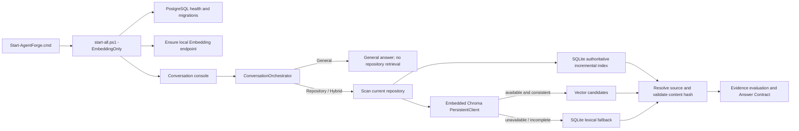
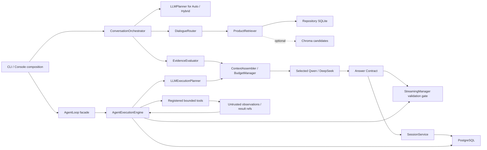
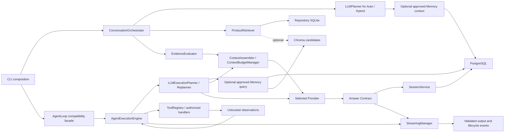
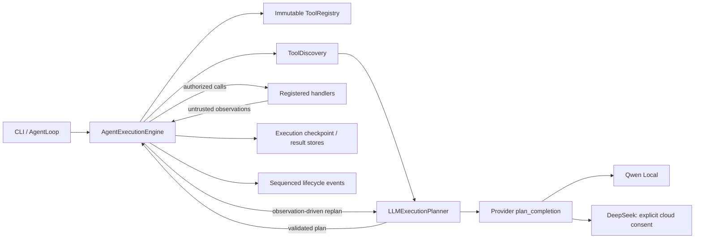
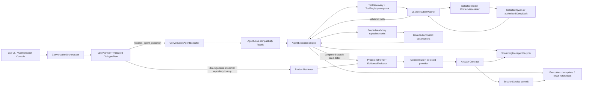
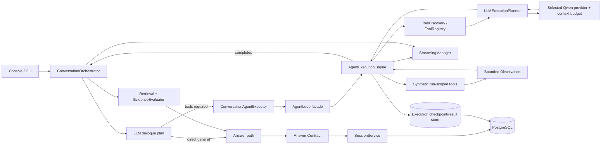

# AgentForge Architecture

## DeepSeek Agent v0.1 release profile (2026-11-09)

New interactive sessions select DeepSeek Flash only after explicit per-session cloud-data consent. The user may choose local Qwen when its credential and service are configured; existing sessions retain their persisted model binding. No provider fallback is silent. This worktree is a **RELEASE_CANDIDATE** within the documented v0.1 scope: targeted real DeepSeek multi-turn acceptance passed after bounded invalid-JSON correction. The full matrix is not claimed as passed; see the release report for remaining exclusions and the unmeasured interactive-launch smoke. See `RELEASE_V0.1_LIMITATIONS.md` for supported and deferred behavior.
The `feature/1.1-core` branch adds development-only multi-repository indexing, bounded history summarization, and cross-file evidence improvements. Published MVP 1.0 remains frozen on `main`/`v1.0.0-mvp` until these changes are separately reviewed and released.

## Phase 5.1 — default vector retrieval and index lifecycle (2026-11-10)



Chroma is an embedded persistent library in the AgentForge process, not a separately managed service. The standard `Start-AgentForge.cmd` path checks or starts the local Embedding endpoint and does not start the optional Qwen chat endpoint; the Chroma client is created lazily when a repository is registered or used. Registration indexes SQLite first and synchronizes vectors when available. Before each Repository/Hybrid turn, the scanner detects changes, SQLite applies incremental updates, and Chroma reconciles the derived index. If Embedding or Chroma is unavailable, SQLite lexical retrieval remains available and lifecycle status reports `DEGRADED_LEXICAL_ONLY`. SQLite remains authoritative: every candidate is resolved and hash-checked against indexed/current source before it can become answer evidence. General turns bypass repository retrieval. This is synchronous scan-and-sync, not a filesystem watcher or background queue. Offline lifecycle and retrieval verification passed; live model/embedding/PostgreSQL acceptance for this phase is not measured.

## Tool discovery and output budget boundaries (2026-11-08)

```text
ToolRegistry ──catalog/schema batches + revision cache──> LLMExecutionPlanner
      │                                                     │
      └──────────── schemas ──> PlanValidator <── plan ─────┘
                                      │ validated plan
                                      v
                             AgentExecutionEngine
                         schedule / execute / observe / replan

CLI or Conversation ──budget mode──> ContextBudgetManager
                                           │ selected model descriptor
                                           v
                               provider request + HTTP limits
```

`ToolRegistry` owns tool registration, discovery, detailed schemas, bounded batch retrieval, and schema cache invalidation when the registered tool revision changes. `LLMExecutionPlanner` chooses tools, parameters, and dependencies; `PlanValidator` rejects unknown tools and invalid arguments; `AgentExecutionEngine` owns execution and observation. Discovery rounds are separately bounded and do not consume execution or replanning steps.

`ContextBudgetManager` resolves `concise`, `standard`, `long`, or `max` against the selected model's verified capability and provider/adapter/context limits. CLI `--output-budget` and console `/output-budget` select a request mode; they do not implement a second model cap. The ordinary default is `standard` (16,384 requested tokens), while current Qwen local configuration is clamped to its 512-token adapter ceiling. DeepSeek test descriptors resolve standard=16,384 and long=65,536; `max` uses only a fresh verified model ceiling. Current cached DeepSeek metadata is stale, so those values are deterministic budget-test outcomes, not current live capability claims. Planner output budgets remain independent.

DeepSeek HTTP request/response byte protections scale with the already-resolved input/output budget and stop at a 64,000,000-byte hard safety bound. Oversized responses fail explicitly; `finish_reason=length` is rejected as incomplete. Thinking and visible completion share the provider's `max_tokens` unless the service reports a separate reasoning usage field; reported reasoning usage is recorded separately, not granted an invented extra allowance. Full test/coverage evidence is recorded in `AF042_TOOL_DISCOVERY_OUTPUT_BUDGET_REPORT_20261108.md`.

## Runtime components

```text
Windows launcher / CLI
        │
        ├── Python orchestration
        │     ├── bounded repository scanner and safe file reader
        │     ├── chunker, Python AST parser, SQLite indexer
        │     ├── intent router and lexical/symbol/static-relation retrieval
        │     ├── default Chroma candidate retrieval with lexical-only fallback
        │     ├── evidence/context builder and Answer Contract
        │     └── conversation and approval workflows
        │
        ├── Local PostgreSQL: conversation and approved-memory authority
        ├── Local Chroma: rebuildable code/memory vector candidates
        ├── Local llama-server: Qwen chat and embedding endpoints
        └── Explicit DeepSeek HTTPS provider: optional cloud chat, no automatic fallback
```

The standard-library CLI and SQLite code-index path can run without a model. Persistent conversations and memory require the optional persistence dependencies and a local PostgreSQL service. Vector retrieval is enabled by default in the normal console path; Chroma is embedded and the configured local Embedding endpoint is checked by the standard launcher. If vector dependencies are unavailable, repository retrieval degrades to SQLite lexical search and exposes the degraded state. Chat generation requires an explicitly selected provider.

The current development worktree uses `ConversationOrchestrator` as the application use case for a turn. `cli.py` remains the composition root: it parses commands and constructs repository, session, memory, model, and persistence dependencies. The Orchestrator runs the selected mode, coordinates retrieval and evidence gates, calls a provider, validates the returned text through the Answer Contract, then persists the turn. It returns a structured result rather than printing it. See `AGENTFORGE_PHASE2_FINAL_INTEGRATION_REPORT_20261106.md` for the latest graph, boundaries, and measured limits; the earlier design file is a historical planning snapshot.

`conversation_orchestrator.py` is the application entry for General, Repository, Hybrid, and Auto turns. Fixed General/Repository modes produce explicit plans; Auto/Hybrid use the selected model's bounded, schema-validated `LLMPlanner`, followed by plan validation and `DialogueRouter`. `evidence_evaluator.py` evaluates route confidence and required source-role completeness. It does not semantically prove relevance or entailment. Providers receive mode-specific prompts through provider-neutral `providers/dialogue_protocol.py`, make the model request, and reject malformed, empty, truncated, or unsupported protocol responses. They return untrusted answer text without deciding which evidence IDs are valid. The Orchestrator's Answer Contract validates request-local IDs, paths, lines, response structure, and required cited roles. A valid citation does not establish that the surrounding natural-language claim is true.

On the `feature/1.1-core` development branch, `model_registry.py` holds local model metadata and explicitly refreshed DeepSeek capability metadata. Registry entries describe model capabilities; health checks describe connectivity. Session records persist provider, model, Thinking/effort settings, and cloud-data consent. New interactive sessions default to DeepSeek Flash after the user confirms the cloud-data notice; the user may explicitly select Qwen Local. Existing sessions are not rebound automatically. There is no silent fallback or automatic cloud routing.

## Retrieval and evidence

`scanner.py` discovers allowed source/document files; `safeio.py` reopens and verifies file identity before reading. `chunker.py` creates line-addressable chunks. `indexer.py` coordinates scanning, parsing and a transactional SQLite snapshot. On the 1.1 branch, `store.py` opens one index at `.agentforge/data/repositories/<repository-id>.sqlite3`; the older `.agentforge/data/index.sqlite3` is retained as a compatibility index for its original owner.

`product_retrieval.py` and `query_routing.py` choose a channel based on query intent. Exact symbols use structured symbol retrieval; import/call/public API questions may use PackageRelation; ordinary concepts and documents use lexical retrieval plus default Vector candidates when available. Resolved static references can add caller/target evidence across files. Candidate paths and content are checked against the current repository/index snapshot before they become context. The offline RRF research path does not replace the default retriever.

`context.py` assigns request-local evidence IDs and constructs source excerpts. The Answer Contract calls its citation parser after generation and validates those IDs against the exact request context. It distinguishes answered, limited and refused outcomes. A valid citation establishes source identity and location, not universal semantic entailment. The application therefore keeps semantic certainty limited where it has no independent proof.

## Persistence responsibilities

| Store | Authoritative data | Scope |
|---|---|---|
| SQLite | Indexed source snapshots, chunks, Python symbols and static references | One file per registered repository identity; a legacy index can remain attached to its original repository |
| PostgreSQL | Repository identities, conversations, messages, history excerpts, memory candidates/approvals/sources/events and vector-sync outbox | Persistent, repository-scoped user data |
| Chroma | Embeddings and searchable metadata for code and approved memories | Rebuildable local candidate index |

PostgreSQL is the source of truth for conversation and memory state. Chroma does not share a transaction with PostgreSQL; an outbox records vector work. Retrieved memories are rechecked against PostgreSQL for repository scope, approval, revocation, expiry, source, and content identity. Code vectors are checked against the SQLite snapshot. Chroma is not the sole source of either code or memory facts.

Database migrations are in `alembic/`; the CLI exposes session migration and management commands. Runtime credentials are supplied through process environment by the Windows launcher; secrets and local stores are excluded from the repository. The additive model-binding revision is `af012mm_004`, with Qwen-compatible defaults for existing conversations. `CredentialStore` keeps the optional DeepSeek key in a Windows-user-bound DPAPI file or reads `DEEPSEEK_API_KEY` as an override; keys are not stored in PostgreSQL or ordinary project configuration. The model-list cache is local metadata, not a connection-status record.

## Conversations and context

`repositories.py` maintains stable canonical-path identities, the active repository setting, and one isolated SQLite index location per repository. CLI and console support registration, listing, switching, indexing, rebuilding, and removal. Registration and first use establish/update the index automatically; repository-oriented turns detect changed files and update the existing index incrementally. Removing a repository refuses the active one and removes only the AgentForge index, registration, and repository-filtered Chroma vectors; source files and PostgreSQL conversation/memory history are retained.

`conversation_store.py` implements conversation/message persistence and repository-scoped selection. `conversation_console.py` is the interactive entry point. Each turn loads the selected conversation, current repository identity, bounded recent history/summary, relevant approved memory when vector retrieval is available, current RAG evidence for repository-oriented plans, and the current question.

History is not unlimited in a model request, but the PostgreSQL message log remains complete. `ContextAssembler` creates a request-only view using the selected model's `ModelDescriptor`; it does not mutate durable messages. Qwen's descriptor comes from the launcher setting `--ctx-size 4096`. DeepSeek capabilities come from an explicit `/models` refresh; a stale cache or missing provenance is display-only and rejected before provider use. The planner calculates `min(context_window - requested_output_reserve - safety_margin, verified_max_input_tokens, optional_user_cap)`. It does not reserve the model's maximum output for every request. Tool requests include tool schemas and protocol history. When full history does not fit, the assembler may include a source-linked summary and newest complete turns; if required content still does not fit it returns `CONTEXT_BUDGET_EXCEEDED` before sending. Summary storage remains separately bounded in UTF-8 bytes, and is not a model-wide context limit. Model-specific tokenizers can be registered locally without downloading assets; absent one, diagnostics explicitly report a conservative estimate rather than exact tokens. Request usage is recorded separately from capacity, with reasoning usage kept distinct when the provider reports it. Repository switching selects the corresponding independent SQLite index and repository-bound conversations; the next repository-oriented turn checks for changes and applies incremental updates.

## Local model boundary

The chat and embedding providers use the explicitly configured loopback llama-server endpoints. The Windows launcher verifies health and model identity before starting the console. Model processes are separate from the AgentForge product process; AgentForge does not provide shell execution, arbitrary repository writes, network tools, or model management through its read-only Agent loop.

The release does not include model weights or runtime binaries. Launchers use `AGENTFORGE_MODEL_ROOT` or a `models` directory next to the project directory. They bind services to loopback and do not download assets.

The DeepSeek provider sends requests only to the fixed official HTTPS host. It separates `reasoning_content` from user-visible `content`, enforces connection/read/total timeouts, validates response protocol, and does not retry. Request-local evidence IDs are validated by the application Answer Contract. Its optional Agent planner exposes only existing read-only search and symbol-list tools; it does not expose shell, arbitrary Python, writes, or network tools. Tool schemas and tool-call protocol history are included in the request budget.

`StreamingManager` tracks conversation and Agent execution lifecycle events, cancellation and approval suspension. Provider deltas remain buffered until answer validation succeeds, so this is validated completion streaming rather than immediate publication of untrusted tokens. DeepSeek has a bounded SSE transport; Qwen does not currently declare streaming support, and Agent JSON planning does not stream tokens. The latest full offline and host-acceptance state is recorded in `AGENTFORGE_PHASE2_FINAL_INTEGRATION_REPORT_20261106.md`.

## Deliberate MVP limits

- Repository identity is derived from the canonical local path; moving a repository changes its identity and requires registering/indexing it again.
- Removing a repository keeps PostgreSQL conversations and Memory for audit/recovery; `repo remove` does not delete that history.
- Python static analysis cannot prove dynamic imports or runtime behavior.
- Chroma vector retrieval is enabled by default in the console and synchronized automatically for repository registration/use; `/chroma on` and `/chroma index` remain maintenance/debug controls. SQLite lexical retrieval is the visible fallback.
- RRF, reranking, and production similarity-threshold refusal are not enabled by default.
- Citation validation checks evidence identity and source text but does not prove arbitrary semantic entailment.
- The delivered host acceptance demonstrates specific local PostgreSQL/Qwen/Chroma scenarios, not general reliability for every repository or query.
- 1.1 offline tests use temporary SQLite and synthetic/test-double Chroma; the new branch has not undergone a fresh real PostgreSQL/Chroma/Qwen acceptance run.
- DeepSeek discovery and cloud inference have not been performed from the current network-disabled environment. Offline protocol tests do not demonstrate live availability, account access, billing, or model answer quality.


## 1.1 conversation summary fact ledger (offline-verified)

`conversation_summaries.fact_ledger` stores conservative source-linked statements extracted from completed user messages. Each record binds a stable fact ID and exact statement text to source message UUIDs, sequence numbers, and full-message SHA-256. These are records of user statements, not verified code facts or model ground truth. Summary writes merge prior ledger entries with newly covered messages and fail closed if any protected statement is absent, the 1,800-byte persisted summary cap is exceeded, or the write transaction fails. The summary cursor advances only with a successful summary save. Migration `af012ctx_003_summary_fact_ledger` is additive. Offline isolated-database tests passed; the formal PostgreSQL migration and a fresh real Qwen summary run remain unmeasured. Input, Prompt, model output, and persisted summary each have separate UTF-8 byte limits; none is an exact Tokenizer budget.

## Phase 2 integrated execution architecture (2026-11-06; not part of frozen 1.0)



General, Repository, Hybrid, and Auto share the same conversation application path; Agent tool execution remains a separate explicit application capability, sharing the selected-model ContextAssembler and persistence/event primitives. This avoids silently turning ordinary repository questions into tool runs. The execution engine handles plan validation, tool authorization, dependency scheduling, observations/replanning, cancellation, approval waits, checkpoint recovery, and large-result references. Current implementation boundaries and acceptance evidence are in `AGENTFORGE_PHASE2_FINAL_INTEGRATION_REPORT_20261106.md`.

Evidence evaluation remains structural rather than semantic entailment verification. Approved long-term Memory is now an optional, bounded Planner input on both the conversation-routing and Agent tool-planning paths; current user input has precedence and PostgreSQL revalidates approval, scope, content version, and source identity. Memory lookup failure is omitted from that request and recorded as a diagnostic. A cancellation request still cannot forcibly terminate a provider request already in transport. The Phase 3 real host check was blocked because PostgreSQL, Qwen Chat, and Embedding had no local listener. Offline coverage remains below the 90% / 85% targets. `main` and `v1.0.0-mvp` remain frozen.

## Phase 3 capability integration (2026-11-06)



This Phase 3 section records the pre-Phase-4 boundary: `ask` used the evidence-grounded conversation path while `agent` exposed the bounded tool loop separately. The current integrated route is documented below; the historical Phase 3 report remains unchanged.

## Iterative Agent execution subsystem (2026-11-06; offline implementation)



The planner and tool runtime use a provider-neutral JSON protocol. The planner sees a small capability catalog first; the full input/output schema is loaded only for selected registered tools. Before dispatch, the engine validates strict arguments, authorization scope, tool definition version, duplicate signatures, task IDs, dependencies, and run limits. Independent read-only worker-safe tasks can run concurrently; concurrency groups and thread-safety flags restrict scheduling. Every tool result is treated as untrusted input for subsequent planning.

An interrupted side-effect call is never automatically replayed. A worker-safe side effect has a bounded wait; if execution began and cancellation/deadline expires, its result is `unknown` and the checkpoint becomes terminal. Thread-affine synchronous handlers can only cooperate with a cancellation signal; Python cannot safely kill their thread, so a timed-out side effect is still marked unknown. This is a residual limitation, not a hard process kill guarantee.

`af013ae_001` adds PostgreSQL execution checkpoints and immutable large-result records. Checkpoints are versioned with compare-and-swap, bound to repository/conversation scope, and contain bounded JSON only. Large tool outputs are kept separately with SHA-256 and paged by execution-scoped reference. The migration is currently the Alembic head but has not been run on the user's database; downgrade intentionally refuses to delete durable execution history.

The current `AgentLoop` wraps its legacy deterministic planner and read-only toolbox through an adapter. Qwen and DeepSeek share the new `plan_completion` port when the CLI selects the LLM planner. This does not replace the normal RAG conversation orchestrator, does not implement native provider function-calling, and does not establish live model/PostgreSQL/Chroma behavior. See `AGENT_EXECUTION_REFACTOR_REPORT_20261106.md`.

## Phase 4 unified conversation and Agent execution (2026-11-07; offline verified)



The `ask` command remains a composition entry and does not own planning or tool execution. The selected model's validated conversation plan sets `requires_agent_execution`; only that branch constructs the existing Agent execution path. The Agent planner chooses registered tools, observes actual results, and replans. Repository search output is compacted for the replanner to source IDs and relative path/line references; the final evidence stage independently selects candidates and reloads checked source text. Tool candidates never bypass EvidenceEvaluator or Answer Contract. General plans skip repository access and Agent execution.

`AgentLoop` is a compatibility facade that builds the existing `AgentExecutionEngine`; there is still one execution loop. The engine snapshots a `ToolRegistry`, so trusted tools can be registered before a run. The conversational executor currently registers only repository search/read/symbol tools and authorizes only `repository:read`. It does not expose mutation or external-network tools. The underlying engine's dependency scheduling, bounded idempotent-read retry, approval pause/resume, checkpoint recovery, cancellation, and terminal handling of unknown side-effect outcomes remain the single implementation. Live approval resume is not exercised by Auto because its current tool set has no side-effect operation.

Both conversation planning and execution planning use the selected provider's descriptor and ContextAssembler. Existing offline tests cover Qwen/DeepSeek request-view switching without deleting stored history; they do not prove current remote model limits or live switching. Session and execution state are persisted through existing PostgreSQL services when a conversation is active. Real model and host database acceptance for this Phase 4 change remains unmeasured. See `PHASE4_UNIFIED_AGENT_INTEGRATION_REPORT.md`.

## Phase 4.1 host validation status (2026-11-07)

The Phase 4 call graph above remains the current implementation path. Full offline tests pass, but real model execution is blocked in this environment: `CODEX_SANDBOX_NETWORK_DISABLED=1`, and no local PostgreSQL, Qwen Chat, or Qwen Embedding listeners were detected. The existing Qwen conversation runner exercises the CLI/Orchestrator path but does not save a conclusive Agent tool-plan trace; the Phase 3.3 runner exercises real Planner/Engine behavior but bypasses the Orchestrator. Do not combine those results into a claimed real Phase 4 end-to-end pass. See `PHASE4_1_ACCEPTANCE_REPORT.md` for the matrix and host gate.

## Phase 4.2 unified host runner (2026-11-07)

The Phase 4.2 Runner calls `ConversationOrchestrator.run` for every dialogue scenario. `ConversationOrchestrator` validates the dialogue plan and routes the turn to `ConversationAgentExecutor`; that service uses the existing `AgentLoop` compatibility facade and shared `AgentExecutionEngine`. The Runner injects only a per-scenario synthetic `ToolRegistry`, a recorder around the real `LLMExecutionPlanner`, and the matching synthetic permission scope. Planner decisions remain real Qwen decisions when the host is available; the Runner does not call the engine directly to simulate end-to-end success.



The full acceptance matrix and trace schema are in `PHASE4_2_ARCHITECTURE_AND_MATRIX.md`. The real-host run remains **BLOCKED** by the current execution's local-network gate; the generated result records zero model requests and no temporary host resources. Offline integration is PASS, while real Qwen decisions, PostgreSQL recovery, Chroma host behavior and DeepSeek are not claimed.

## Phase 4.3 tool discovery and execution boundary (2026-11-08)

The Phase 4.3 path and ownership boundaries are documented with a Mermaid graph and responsibility matrix in `PHASE4_3_ARCHITECTURE_AND_DEPENDENCY_GRAPH_20261108.md`. The conversation Planner sees a small metadata-only catalog obtained through the executor's configured registry and authorization policy. This is a preview, not a grant. The execution Planner discovers the current authorized catalog again, loads schemas only for selected exact IDs, and passes the resulting plan through `PlanValidator` before any handler runs.

Answer Intent (`general`, `repository`, `hybrid`) no longer decides whether the Agent Engine may run. `requires_agent_execution` is a separate validated decision. General tool use is available only with an explicitly injected registry and authorization factory; repository tools still require the selected repository and `repository:read`. An unavailable tool is removed from the next catalog, but other authorized alternatives remain visible. An empty fallback catalog or an invalid second schema selection fails closed.

The existing `AgentExecutionEngine` remains the sole execution loop and does not depend on `ConversationOrchestrator`. The latter coordinates planning, execution handoff, retrieval/evidence processing, Answer Contract, streaming events, and persistence. Real-host evidence for the four requested Phase 4.3 scenarios and remaining NOT_MEASURED areas is in `PHASE4_3_TOOL_BOUNDARY_REPORT_20261108.md` and `PHASE4_3_TOOL_BOUNDARY_RESULTS_20261108.json`.


## Phase 4.4.4.2 — Planner contract and bounded result paging

The shared Planner rule table feeds both prompt wording and deterministic intent/task validation. Tool tasks remain orthogonal to General/Repository/Hybrid answer intent, while the execution flag must match actual tool-task presence. One correction is bounded and every corrected plan is fully revalidated.

The existing AgentExecutionEngine remains the sole execution loop. It adds a run-scoped, read-only page reader to its registry snapshot only when the same run contains a partial result reference. The tool enforces execution scope, schema, page size, output bounds, offsets and hashes. Observations retain the reference as pages are consumed, and bounded page text/provenance reaches final context. The existing Evidence Evaluator and Answer Contract remain in the final path.

See `PHASE4_4_4_2_ARCHITECTURE_CHANGELOG.md`. Offline validation passed; live DeepSeek acceptance is BLOCKED in the current environment.


## Phase 5.2.2 — independent planning and optional repository context

Auto planning now has independent, schema-validated capability axes: repository tasks request current-source retrieval; tool tasks request the existing authorized Agent execution path. The legacy intent value remains in the validated plan for compatibility and does not derive whether repository retrieval occurs. ProductIntentRouter continues to choose lexical, symbol, package-relation, and vector channels after retrieval has been requested.

```text
Current user message + bounded conversation history
                         |
                 LLMPlanner (Auto)
                 /               \
    repository-task flag       tool-task flag
             |                       |
  optional ProductRetriever    existing Agent authorization,
             |                 schema and execution checks
 SQLite + optional Chroma               |
 source/hash verification          Observation
             |                       |
 verified evidence or none  <--- bounded tool context
             \                       /
              existing provider answer path
              (optional evidence when needed)
                         |
          existing Answer Contract + Session commit
```

Missing index, empty/low-relevance results, and classified safe retrieval failures produce no source evidence rather than fabricated evidence; a generative provider may still answer under the existing optional-evidence contract. SQLite remains authoritative. Chroma/Embedding failure can leave lexical evidence available, and the returned lifecycle remains degraded. Wrong repository, stale source, invalid path/range, or invalid citation does not become evidence. The current General/Hybrid provider and contract APIs remain as a transitional implementation; final answer schema/prompt unification is deferred to Phase 5.2.3. AgentExecutionEngine, ToolRegistry authorization, approvals, dependency validation, context budgets, persistence schemas, and Chroma storage were not changed.

Implementation references: Planner data and parser in agentforge/planner.py:59-100 and prompt at :438-453; independent projection in agentforge/dialogue_router.py:31-78; optional retrieval and answer selection in agentforge/conversation_orchestrator.py:247-507 and safe failure mapping at :1061-1090; stateless ask probe in agentforge/cli.py:503-516 and :889-899; safe evidence exception in agentforge/product_retrieval.py:48-51, :117-197. Offline behavior tests are in tests/test_planner.py, tests/test_dialogue_router.py, tests/test_conversation_agent.py, and tests/test_cli.py.

## Phase 5.2.2.1 — request lifecycle observability

The interactive presentation entry creates one request tracker and binds it through the CLI/orchestrator call path. Instrumented stages report progress to stderr and JSONL without intercepting model prompts or answer content. The tracker records bounded, allowlisted metadata only; per-request session and tool-call identifiers are one-way fingerprints. Provider instrumentation observes response headers, first streamed delta, finish reason, and usage from existing provider statistics; it does not change request options, budgets, retry behavior, or provider streaming capability.

```text
Interactive presentation entry
  ├─ create request ID / bind lifecycle context
  ├─ CLI: session restore → memory/embedding readiness → Chroma setup
  └─ ConversationOrchestrator
       ├─ Planner request → plan validation → bounded correction
       ├─ repository preparation → SQLite / vector retrieval
       │    → merge/rerank → source/hash validation → context assembly
       ├─ existing AgentExecutionEngine events
       │    → tool / approval / observation / cancellation
       ├─ final provider request → Answer Contract
       └─ session persistence → request summary

Lifecycle events ──→ stderr progress + bounded JSONL
Validated answer ──→ stdout
```

Default log location: `.agentforge/logs/request-lifecycle.jsonl`; active file limit 2 MiB and three rotated backups. The metadata allowlist excludes prompt text, source contents/paths, raw tool arguments, API keys, database credentials, raw session IDs, and raw call IDs. Logging, console, and telemetry failures are swallowed so diagnostics do not change the application operation.

Timeout audit: Planner chat requests use its existing 60-second request override; the correction request has the same bound. CLI provider defaults remain connect 2 s, read 60 s, total 180 s; the interactive console overrides read wait to 120 s. The shared Agent planner uses `min(60 s, tool-timeout)` (default 30 s), and its run limit remains derived from existing tool timeout and max-step settings. DeepSeek client class defaults are connect 5 s / read 90 s / total 180 s when not overridden by the CLI. Local Qwen client defaults are connect 2 s / read 60 s / total 180 s; the console sets read to 120 s. Embedding HTTP has connect 2 s and read 60 s, but no whole-call deadline. Chroma/index operations expose no separate operation deadline, and the application has no single end-to-end request deadline spanning restore, retrieval, tools, generation, and persistence. No timeout values were changed in this phase.

Static dependency analysis found no cycles and no prohibited application/provider edges. Runtime and dynamically imported edges are outside this scan. Provider-native streaming was not measured against a live endpoint; the recorded lifecycle does not claim it was.

## Phase 5.2.2.2 — Repository retrieval and request UX

Bound-repository retrieval is coordinated independently from Planner tool-execution decisions. The configured repository retriever combines SQLite lexical/symbol channels with Chroma candidates; SQLite source content and provenance checks remain authoritative. Warm index snapshots and unchanged-file reuse reduce repeated work; bounded embedding/write batches preserve incremental synchronization. Known semantic-summary input overflow has a read-only history-context fallback that preserves original stored messages. The console defaults to concise progress and keeps the existing sanitized lifecycle log for debugging. Live performance and real repository vector retrieval were not measured in this phase; see the phase host report.

## Phase 5.2.2.2 — Repository retrieval and request UX

Bound-repository retrieval is coordinated independently from Planner tool-execution decisions. The configured repository retriever combines SQLite lexical/symbol channels with Chroma candidates; SQLite source content and provenance checks remain authoritative. Warm index snapshots and unchanged-file reuse reduce repeated work; bounded embedding/write batches preserve incremental synchronization. Known semantic-summary input overflow has a read-only history-context fallback that preserves original stored messages. The console defaults to concise progress and keeps the existing sanitized lifecycle log for debugging. Live performance and real repository vector retrieval were not measured in this phase; see the phase host report.

## Phase 5.2.2.3 — hot index and reliable answer evidence

Current request flow:

CLI ask (Chroma enabled by default) → repository preparation → filesystem metadata scan → incremental SQLite synchronization → persistent Chroma reconciliation → ConversationOrchestrator → one primary current-question ProductRetriever search → SQLite lexical/symbol channels plus configured Chroma vector channel → merge/deduplicate → SQLite source/path/range/hash verification → bounded ContextAssembler → provider → existing Answer Contract.

A bound repository triggers retrieval independently of Planner tool-execution intent. A low-confidence or unresolved explicit symbol can cause one bounded supplementary symbol lookup; it is a refinement, not a repeated copy of the same primary query. No evidence or a safe retrieval failure remains an optional-context case; it does not fabricate source facts or suppress the general answer path.

Warm index reuse is process-local and only applies when file identity metadata and the authoritative SQLite snapshot match. Chroma compares stable identities, metadata and vector validity, batches changed documents up to 16, skips valid unchanged vectors, and only removes stale items after required writes succeed. SQLite remains authoritative for source text and provenance. The repository's configured Chroma directory is .agentforge/data/chroma; collection naming is derived from the selected embedding model identity. This phase did not open existing Chroma contents.

For semantic-summary overflow, only the known summary failure codes activate a read-only raw-history fallback. ContextAssembler selects the request-local summary and recent complete turns under the selected model budget and retains the current question and required tool observations. The persisted history is not rewritten. One whole-turn deadline spanning restore, index, retrieval, tools, generation, and persistence remains unimplemented; existing individual request deadlines do not provide that end-to-end guarantee.

Offline tests passed, including the full suite. Real-host retrieval and timing were BLOCKED/NOT_MEASURED because local PostgreSQL and Embedding services were unavailable. No Phase 5.2.3 changes were started.

## Phase 5.2.2.3 — final evidence update (2026-11-11)

For a bound repository turn, the application performs one primary ProductRetriever search. Its retrieval channels combine SQLite lexical/symbol results with configured Chroma vector candidates; Chroma performs separate code/document collection queries within the vector channel. Candidate merging now deduplicates provenance, reserves required evidence roles, and interleaves channel rankings so an early full lexical channel cannot starve vector evidence. SQLite remains authoritative for source text, path, line range, and content hash validation.

The corrected merge was validated with behavior tests and a local query against the real persistent collection. The current collection held 599 vectors and its data digest was unchanged by this read-only query. One file's SQLite size snapshot is stale, so whole-repository lifecycle status is STALE even though the returned candidates passed source/hash validation.

A real DeepSeek summary-overflow event used the existing bounded history fallback and proceeded through final-answer generation, Answer Contract, and Session Persistence. The answer contract reported limited. The same host run's Runner later failed to extract its post-run result (AttributeError without stack detail), so the host integration remains PARTIAL. The real DeepSeek run predates the candidate merge fix; post-fix vector-evidence injection into DeepSeek is NOT_MEASURED. No additional provider request was made.

## Phase 5.2.2.3-R1 evidence update (2026-11-11)

The indexer now persists the scanner's original on-disk byte size separately from normalized decoded source content, preventing BOM bytes from making an otherwise hash-identical file appear stale. A single verified SQLite metadata row was corrected; source content, hash, chunk rows, and the persistent vector collection were preserved. Measured request flow confirms one ProductRetriever invocation combines SQLite lexical/symbol retrieval with separate Chroma code/document query channels, then verifies returned content against SQLite. Summary overflow takes a bounded request-context fallback while retaining persisted history. A no-evidence Hybrid answer still fails closed when the model emits an uncited repository section; this run demonstrates that answer policy/assembly must preserve a general answer while keeping repository claims evidence-gated. No contract was weakened in this phase. R1 is PARTIAL; provider-native streaming and scenario C remain unmeasured.

## Phase 5.2.2.3-R2 — observed unified answer behavior (2026-11-11)

For every bound-repository turn, the application now performs repository retrieval independently of the Planner's requires_repository_retrieval value. A validated evidence set is optional context; with no effective evidence, the general provider path runs without fabricated citations. In the host matrix, scenario B proved that a Planner general/no-retrieval plan still caused one application search and then returned a non-empty general answer with no repository citation.

When source evidence enters context, citation identity and source hashes are checked against request-local evidence mapping. The Answer Contract deliberately reports limited while semantic entailment has no independent verifier. Agent tool Observations enter the final answer prompt, but the host run found that their source provenance is not currently mapped into the Answer Contract evidence set; such answers therefore remain limited rather than being promoted to evidence-verified claims.

C2 explicitly selected read-only search and read; ToolDiscovery authorization, schema loading, PlanValidator, dependency order, AgentExecutionEngine observations, answer generation and Session restore were observed. The Runner currently aggregates application retrieval and a planned search tool call into one counter. The two calls in C2 do not alone establish accidental duplication.

The DeepSeek Flash host matrix used synthetic data only. 11/11 Chat requests succeeded, 0 retries. The persistent Chroma collection remained at 599 formal vectors and its full digest matched before/after cleanup. Overall phase status is PARTIAL; Provider-native token streaming and independent semantic entailment remain NOT_MEASURED.

## Phase 5.2.2.3-R3 — verified tool evidence provenance

The ConversationOrchestrator may promote a tool read to repository evidence only when it can link a completed request-local search/read execution to the bound repository and an authoritative SQLite chunk. Retrieval candidate identity hashes and raw SQLite text hashes are validated under separate contracts; the SQLite hash is carried into `EvidenceProvenance` and the Answer Contract. Generic tool output remains an observation. The Answer Contract was not weakened; semantic entailment remains LIMITED. R3 implementation details and verification boundaries are documented in `PHASE5_2_2_3_R3_ARCHITECTURE_CHANGELOG.md`.

## Phase 5.2.2.3-R3.1 — test temporary-resource boundary (2026-11-11)

No production architecture or runtime behavior changed in R3.1. The seven affected index/retrieval tests now allocate unique temporary repositories below the project-local `.tmp/phase5_2_2_3_r3_1` root, avoiding the restricted system-temp location. Existing source-authority, SHA-256, provenance, permission, and Answer Contract checks remain unchanged. The full offline suite passed once with six platform skips. The current DeepSeek C2 flow and persistent Chroma digest comparison remain unmeasured because the current process network gate is disabled; this test-fixture repair is not evidence of host acceptance.

## Phase 5.2.2.3-R4 — diagnostic only (2026-11-11)

No architecture or runtime code changed in R4. Source inspection confirmed Read input schema validation is followed by stricter scanner/path/range checks. Execution records failed tool results and request signatures; identical tool+argument signatures are rejected on later planning. The R3.1 trace did not preserve enough data to identify the specific Read rejection or duplicate-call branch. No implementation or host retest was performed.

## Phase 5.2.2.3-R4.1 — bounded Read retry and C2 host gate (2026-11-11)

The worktree keeps Read path/schema authorization and call identity checks. Only a failed, explicitly idempotent, read-only, non-side-effecting invocation can receive one safe replan retry; successful or uncertain/side-effect outcomes remain non-replayable. The C2-only Runner now omits mutating active-repository diagnostics. The current real host attempt did not reach the execution architecture because model capability metadata was stale; no C2 behavior is inferred from that run.

## Phase 5.2.2.3-R4.2 capability-cache audit — 2026-11-11

No production changes were made. The current model registry delegates refresh to DeepSeekClient.list_models, which calls GET /models and replaces the cache with the complete returned model set. The existing architecture has no single-model capability refresh interface; Tool Calling remains unknown until authoritative metadata can be obtained under an allowed mechanism.

## Phase 5.2.2.3-R4.2.1 — acceptance evidence input and C2 stop point (2026-11-11)

Only the acceptance Runner and its focused tests changed in this phase. The Runner can consume a pinned, time-bounded synthetic runtime-probe evidence record for C2 preflight without changing production capability metadata; it enforces a 26-Chat C2 cap. Production execution architecture, permissions, and model configuration logic were not changed. The real C2 run passed plan validation after one correction and discovered the authorized read-only catalog, but the accepted plan had repository retrieval false and tool execution true. Before schema load or dispatch, the existing ConversationAgentExecutor guard rejected General tool execution without explicit registry/authorization factories. The exact single-component root cause remains unresolved; no production defect is asserted from this one run. Search/Read and downstream answer/evidence stages remain unmeasured.

## Phase 5.2.2.3-R4.2.2 — Planner/Executor integration result (2026-11-11)

The R4.2.2 worktree fixes two confirmed integration mismatches: the default bound-repository read-only registry can serve an independently planned tool call, and ContextAssembler validates the bounded Observation metadata emitted by ConversationOrchestrator while keeping untrusted observation text separate from verified repository evidence. Unknown metadata and malformed bounds remain rejected.

The final host attempt confirms Search and Read dispatch through the Agent Engine, but does not prove end-to-end source evidence: retrieval found a candidate and produced zero effective evidence; the completed Read did not yield a verified provenance source ID; the Answer Contract correctly returned `limited`. The Runner does not preserve a sanitized per-predicate provenance rejection reason, so the exact mismatch remains NOT_DETERMINED. Do not treat a successful tool response as a verified source citation. v0.1 freeze remains NOT_READY.


## R4.2.3 evidence-chain closure (20261112_011027)

The synthetic C2 host path now demonstrates one verified retrieval Evidence (SQLite authority + path/line/SHA-256), authorized Search and bounded Read recovery, Observation-to-context linkage, final answer production and Session restore. The Runner accepts only a single INVALID_ARGUMENTS Read followed by a distinct successful Read; it does not waive schema/range validation. Answer Contract remains LIMITED pending independent semantic entailment verification. This phase is PARTIAL and does not establish v0.1 freeze.

## v0.1 frozen architecture status (2026-11-12)

The v0.1 workflow uses the existing ConversationOrchestrator, Planner, authorized ToolRegistry, AgentExecutionEngine, SQLite-authoritative repository evidence, Chroma-derived vector candidates, ContextAssembler, Answer Contract, and Session persistence. The R4.2.3 synthetic C2 trace historically verified retrieval, Search/Read execution with bounded recovery, source/hash provenance, answer context, DeepSeek final answer, and Session restore.

Answer Contract remains LIMITED: provenance and request-local citation linkage are checked, but independent semantic entailment is not. This is an accepted v0.1 limitation. Provider-native token streaming is NOT_MEASURED. No architecture or safety contract was weakened during final closure.

## Optional repository evidence and streaming draft path (2026-11-12)

For a bound repository, `ConversationOrchestrator` still attempts retrieval independently of planner tool execution. Only validated evidence enters answer context. Zero evidence or a retrieval preparation failure leads to a normal selected-provider answer attempt with an explicit unavailable signal; the general Answer Contract allows a limited answer without inventing repository citations. A clarification plan continues to skip tool execution.

When DeepSeek streaming is enabled, Provider SSE deltas flow through `StreamingManager` to the console as unverified draft text. The final provider completion must exactly match the deltas before answer-contract validation and session persistence. The UI displays the validated status after persistence and does not print the answer a second time. Streaming-off remains buffered. Local tests validate these boundaries; live DeepSeek streaming is NOT_MEASURED.

## v0.1 frozen architecture status (2026-11-12)

The v0.1 workflow uses the existing ConversationOrchestrator, Planner, authorized ToolRegistry, AgentExecutionEngine, SQLite-authoritative repository evidence, Chroma-derived vector candidates, ContextAssembler, Answer Contract, and Session persistence. The R4.2.3 synthetic C2 trace historically verified retrieval, Search/Read execution with bounded recovery, source/hash provenance, answer context, DeepSeek final answer, and Session restore.

Answer Contract remains LIMITED: provenance and request-local citation linkage are checked, but independent semantic entailment is not. This is an accepted v0.1 limitation. Provider-native token streaming is NOT_MEASURED. No architecture or safety contract was weakened during final closure.

## v0.1 Fast Track answer/streaming fallback — 2026-11-12

The no-verified-evidence path continues to the configured answer provider, and provider-interface failures remain explicit rather than silently substituting OfflineProvider. Unknown/unsupported DeepSeek native Streaming uses the complete buffered-answer route. A recoverable stream interruption or completion/delta mismatch allows at most one buffered recovery through the same provider; partial draft state is invalidated, and the final answer continues through the existing Answer Contract and Session path. Focused offline tests passed 26/26. Live DeepSeek, native SSE, and Session persistence were NOT_MEASURED because PostgreSQL and Embedding host prerequisites were unavailable. No model or token budgets, evidence checks, or tool permissions were relaxed.

## v0.1 Fast Track continuation — 2026-11-12

No architecture or production-code change was made in this continuation. The no-evidence retrieval candidate/effective-evidence distinction was observed (5/0), but a live final answer and Session commit were not verified. Unknown Provider-native Streaming remains NOT_MEASURED. The current Chroma Collection retains the historical identity and all 599 vectors map to SQLite source hashes; physical Chroma file hash differs from the prior snapshot and remains unexplained.


## v0.1 No-Evidence Answer Verification — 2026-11-12

When retrieval yields no verified repository evidence, ConversationOrchestrator uses the general Provider answer path, then build_general_contract validates non-empty output and rejects fabricated citations while recording accepted model knowledge as limited. The product entry renders limited, and SessionService persists the completed turn with Provider usage metadata. The current DeepSeek Flash path was verified end to end; this does not claim repository grounding or native Provider streaming.

## v0.1 Final Closure — 2026-11-12

No production architecture changed in this closure. DeepSeek Flash capability metadata reported native Streaming as unknown, so the existing console and Provider guards kept /stream on on the buffered answer path. Two Chat calls completed and the answer was persisted; native SSE remains NOT_MEASURED. The SQLite index metadata timestamp refreshed through normal repository preparation. The Chroma collection's logical ID/provenance digest remained consistent, but a read-only PersistentClient audit altered physical files; investigate only under a separately scoped data-protection plan.


## Phase 5.2.4 Data Integrity Findings — 2026-11-12

No production architecture changed. The formal Chroma store was not opened through PersistentClient during this phase. File-level hashing and immutable-copy analysis showed 599 vectors with complete SQLite source mappings; same-version client reads mutated physical bytes on isolated copies without changing logical collection data. Repository Registry remains separate, with five inactive dangling temporary test records and no recovered full historical row baseline. Application SQLite and PostgreSQL Session were checked separately. Overall data protection remains PARTIAL.


## V0.1 no-evidence Answer Contract repair — 2026-11-12

General answers without verified repository evidence now use a dedicated sanitizer for unknown `[E#]` markers and remain `LIMITED`; this does not weaken evidence-backed validation. A non-empty cleaned answer proceeds through the normal display and persistence path; only an empty cleaned answer can request one bounded same-provider correction. When native Provider Streaming capability is unknown, the answer remains buffered until contract validation. The live run confirmed a general answer and cross-process Session restore, but also exposed that repository preparation automatically scans the bound repository; no vector changes were reported, yet this crossed the acceptance no-reindex boundary. Overall host/data-protection status is PARTIAL, not release-ready.
## v0.1 Final Acceptance State — 2026-11-12

No runtime architecture changed in Phase 5.2.5. Current SQLite remains the authoritative source index and its 195-file/599-chunk content passed read-only source/hash verification. Chroma remains a derived vector index; an isolated byte-copy confirmed all 599 source mappings. Repository preparation on a cold process scans and reparses unchanged files before persistent hash sync reports no changes. The general no-evidence path and historical Session restore passed in a prior real DeepSeek run; current Session integrity is blocked by unavailable read-only database authentication. See V0_1_FINAL_DATA_AUDIT_REPORT.md and V0_1_FINAL_CHROMA_AUDIT_REPORT.md.
## Phase 5.2.6 final storage and release verification — 2026-11-12

Session storage is PostgreSQL through the ConversationStore/SessionService path. The launcher obtains AGENTFORGE_DB_PASSWORD from the current-user DPAPI file through Get-ConversationDatabaseKey and injects it only into the Python child. The Registry and authoritative source index remain separate SQLite databases; Chroma is the derived persistent vector index. The Phase 5.2.5 Session block was an audit harness that omitted the DPAPI helper, not a production configuration failure. Phase 5.2.6 authenticated through the existing helper and verified the current Session in a read-only transaction. See V0_1_PHASE_5_2_6_DATABASE_DIAGNOSTIC.md and V0_1_PHASE_5_2_6_SESSION_AUDIT.md.
