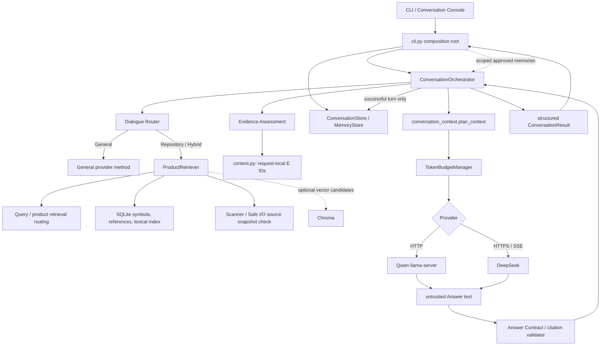

#> Current implementation status is summarized in the Phase 2 addendum at the end of this document. Earlier route diagrams and tables are the chronological pre-implementation audit, not the current behavior.

 AgentForge 对话系统架构设计（当前工作树）

日期：2026-11-06  
实施基线：`feature/1.1-core` / `09bc079ad17b1a2560199eadd679b72c7c779224`  
状态：离线实现与回归完成；真实宿主验收未测；整体 `PARTIAL`。

## 一次对话的实际路径



主要调用关系：

```text
CLI 解析和组合依赖
  -> ConversationOrchestrator.run
  -> plan_dialogue
  -> (Repository/Hybrid) ProductRetriever 与 candidate selection
  -> EvidenceAssessment 和 evidence-role gate
  -> BuiltContext + bounded conversation context
  -> Provider.answer / answer_general / answer_hybrid
  -> Answer Contract 验证本次回答
  -> PostgreSQL turn persistence
  -> structured result
```

## 当前模块职责

| 模块 | 负责 | 明确不负责 | 当前边界状态 |
|---|---|---|---|
| `conversation_console.py` | 交互输入、菜单和结果显示 | 检索、引用校验、数据库事务 | UI 仍通过 CLI facade 调用 |
| `cli.py` | 参数解析、服务构造、权限/同意检查和依赖装配 | 一次问答的完整检索/生成/合同流程 | 仍是大型组合根，也含仓库/会话/Memory 管理命令 |
| `conversation_orchestrator.py` | 协调一次对话；排序 Router、检索、门禁、模型、Answer Contract 和成功持久化 | 直接打印、解析命令行、实现底层 SQL/向量算法 | 已从 CLI 分离；仍承担多个用例步骤，后续可按证据再分服务 |
| `dialogue_router.py` | 显式模式保留；Auto 按确定性词法规则选择能力 | 检索、模型选择、证据可信度、云端授权 | 职责单一；Auto 不是语义 Planner |
| `product_retrieval.py` + `query_routing.py` | 仓库索引通道选择、符号/词法/关系/可选向量召回 | 最终回答、Answer Contract | 保持候选为候选；仍有 product routing 与 dialogue routing 两层 |
| `dialogue_retrieval.py` | 会话追问符号解析、候选窄化和排序辅助 | 索引写入、模型回答 | 从 CLI 抽离；仍使用内部下划线 helper 接口 |
| `evidence_evaluator.py` | 评估检索路由置信度、候选正分和问题所需证据角色是否齐全 | 证明段落语义相关或自然语言结论受源码蕴含 | 明确为结构性评估，不冒充语义判断 |
| `context.py` | 选定 `SearchResult` 转成请求本地 `Evidence(E1...)`，来源 ID 解析到路径/行号/原文 | 查询召回、跨轮历史、长期记忆 | RAG 证据上下文 |
| `conversation_context.py` | 会话历史、摘要、事实账本、Memory、预算选择 | 产生仓库证据身份 | 对话上下文策略 |
| `providers/dialogue_protocol.py` | Provider-neutral 系统指令、消息框架、上下文计划和模型预算前置检查 | 网络请求、检索、引用判定 | 名称在 providers 包下，但逻辑供 Qwen/DeepSeek 共用；仍是提示与 Context 计划的组合点 |
| `providers/llama_server.py` | Loopback HTTP 传输、Qwen 适配、完整/非空/截断响应检查 | 选择路由、验证引用、做离线回退 | Provider 仅返回不可信模型文本；空证据会报错 |
| `providers/deepseek.py` | 固定官方 HTTPS、认证、超时、无重试、SSE/Thinking/usage、响应协议检查 | 路由、引用验证、自动云端回退 | Provider 仅返回不可信模型文本；云调用仍需授权 |
| `answer_contract.py` | 检验请求本地来源 ID、路径/行号、角色覆盖、General/Hybrid 分区和合同状态 | 检索、重新排序候选、证明自然语言语义蕴含 | 各模式统一的应用层回答验证边界 |
| `model_registry.py` / `model_types.py` | 中立模型描述、能力元数据与显式缓存发现 | 会话问答策略 | 描述结构与网络 Provider 已解耦 |
| `token_budget.py` | 按模型窗口/输出预留/安全余量估算或使用明确 Tokenizer | 摘要内容、证据相关性 | 独立预算模块；估算值仍明确标记 |
| `conversation_store.py` / `memory_store.py` | PostgreSQL 会话、消息、摘要、Memory 生命周期及 Outbox | 生成模型回答 | 持久层；CLI 仍负责装配和命令操作 |
| `embeddings/*` / Chroma | 写入/召回可重建向量候选 | 作为事实源或绕过来源复核 | SQLite / PostgreSQL 仍是权威内容来源 |
| `agent_loop.py` | 独立、有界、只读工具 Agent Loop | 普通 `ask` 的通用模式路由 | 独立产品路径；不和 ConversationOrchestrator 混用 |

## 模式与证据合同

| 模式 | 必需能力 | 无证据时的产品行为 |
|---|---|---|
| General | 通用 Provider；不读取仓库索引 | 返回有限通用结论；不允许产生未经授权的源码引用 |
| Repository | 当前仓库检索和证据门禁 | Provider 不被调用；使用明确的证据不足拒答 |
| Hybrid | General Provider + 可选的有效仓库证据 | 保留通用部分；Repository 部分必须引用适用证据或说明无法确认 |
| Auto | 词法意图规则选择 General/Repository/Hybrid | 采用选出的模式；歧义下可能误分，需用户显式指定模式 |

证据生命周期按当前应用实现分层：

1. `ProductRetriever` 产生带通道、角色和解析状态的候选。
2. candidate selection/evidence evaluator 判断路由置信度和必需角色覆盖；它不作语义蕴含证明。
3. `context.build_context` 为使用的源码片段分配请求本地 Evidence ID。
4. Provider 返回模型文本，不验证 ID，也不生成权威路径或行号。
5. Answer Contract 检查 ID 是否属于本次请求、角色是否被引用、General/Hybrid 来源分区是否合法。
6. 合同状态保持 `limited`，除非系统有独立来源证明；当前实现不做通用语义蕴含验证。

所以：“搜到证据”不等于相关证据，“回答引用了证据”也不等于结论已被证明。检查来源和结构不能取代独立的语义判断。

## 会话和上下文生命周期

- CLI 为当前仓库解析稳定 `repository_id`，加载绑定该仓库的 PostgreSQL conversation 和 model settings。
- 已批准且匹配仓库/全局作用域的 Memory 作为不可信上下文候选传递；其审批/有效性由 PostgreSQL 复核。
- Orchestrator 准备摘要、source-linked fact ledger 和最近完整消息；模型输入由 `conversation_context.plan_context` 按预算选择。
- `TokenBudgetManager` 按模型元数据分配输入窗口和输出预留。没有精确 tokenizer 时标记 `estimated`。
- 生成及 Answer Contract 通过后，Orchestrator 才持久化本轮消息；失败不会把未验证的回答标成成功。
- Qwen 和 DeepSeek 可按会话绑定选择；DeepSeek 需要显式云数据同意。不存在 Provider 静默切换。

## 当前未完成的架构目标

- 没有统一的 `SessionManager`/`MemoryManager` 应用端口；CLI 仍构造并协调底层 store/Chroma 对象。
- `ConversationOrchestrator` 已分离，但还有较多一轮流程分支；只有在测试或维护需求表明有收益时再拆。
- `dialogue_protocol.py` 仍同时负责提示框架和对话上下文/Token 预算编排，虽然内容对 Provider 中立。
- `evidence_evaluator.py` 只做结构检查；没有独立语义相关性/蕴含模型。
- Auto 是小型词法规则，不理解复杂意图树。
- 没有跨 Provider 统一的 Streaming Manager。DeepSeek 有 SSE；Qwen 当前注册能力不确认并拒绝流式请求。
- 本轮未真实连接 PostgreSQL、Qwen、Embedding 或 DeepSeek；Chroma/DB 宿主组合需由普通 Windows 宿主验收。
- 全包覆盖率未达门槛：见 `DIALOGUE_SYSTEM_COVERAGE_REPORT_20261106.md`。

## 依赖图与验证

当前工作树的单向模块图见 `DIALOGUE_SYSTEM_DEPENDENCY_GRAPH_20261106.md`。静态 AST 检查读取了 73 个 `agentforge` Python 模块，未发现强连通导入环。完整测试矩阵和限制见 `DIALOGUE_SYSTEM_FINAL_REPORT_20261106.md`。

## Phase 2 implementation status (authoritative current worktree, 2026-11-06)

Earlier sections preserve the pre-implementation audit and design targets. Current code adds a strict JSON plan with intent, task records, retrieval queries, dependencies, capability flags, answer strategy, clarification flag, confidence, and short reason. Auto/Hybrid call the selected provider once with bounded history, output tokens, timeout and model-aware input budget. Explicit General/Repository remain fixed. Valid repository queries drive retrieval and the plan outline is sent to final generation.

There is no iterative replanning after retrieval, separate general-task execution, ToolRegistry, or external data fetch. External-only requests stop safely.

SessionRepository, MemoryRepository, PlanningModelPort, and StreamingEventSink are protocols located with their service modules rather than a dedicated Ports package. CLI remains the composition root and owns several lifecycle commands. ConversationOrchestrator coordinates multiple application stages. Evidence evaluation remains structural; it cannot prove semantic relevance or claim entailment. Streaming content is buffered until contract validation and cancellation is checked at stage boundaries only. TokenBudgetManager uses per-model descriptor limits; exact TokenizerAdapter injection exists, but this run used conservative estimated counting.

AST inspection covered 77 agentforge modules, with no parse errors or static import cycles; this does not prove runtime coupling is absent.
