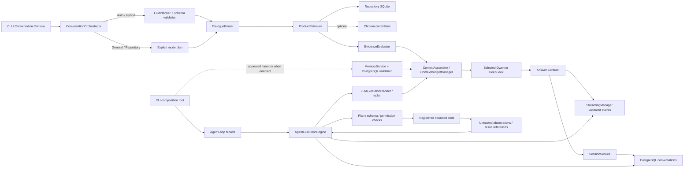
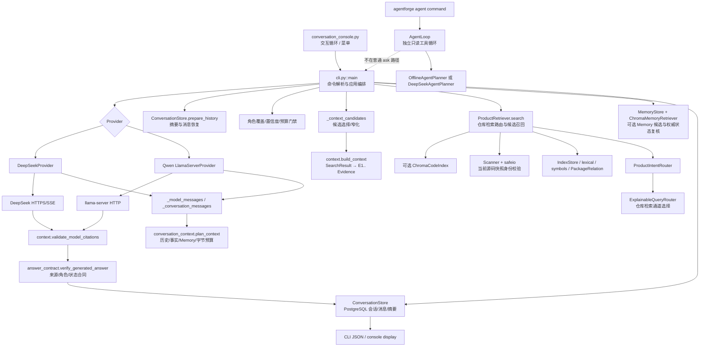
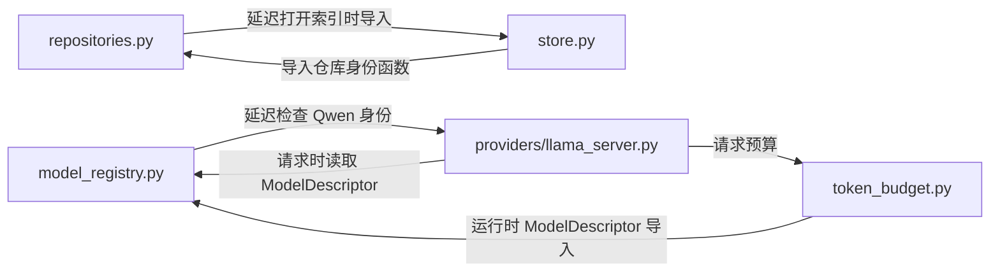
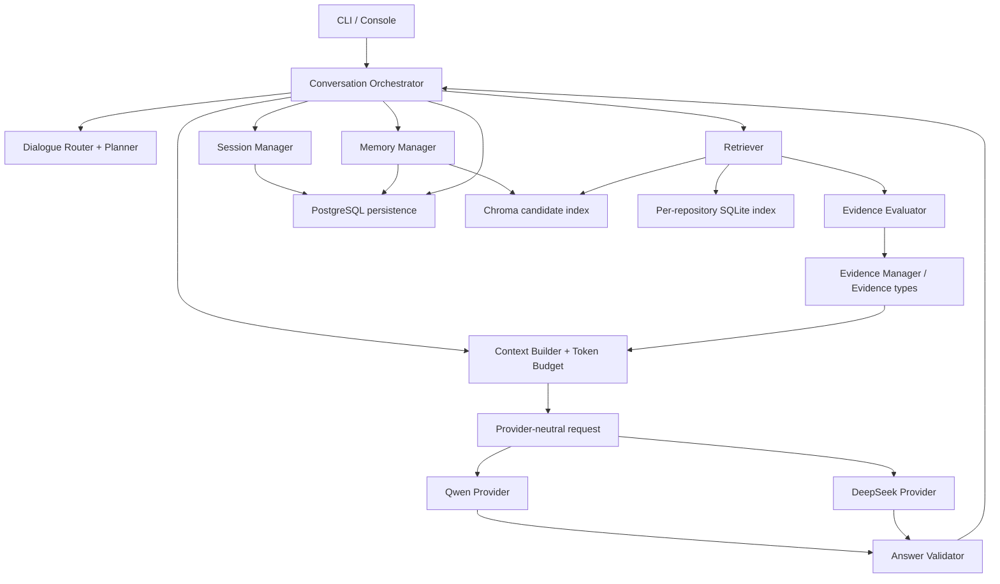
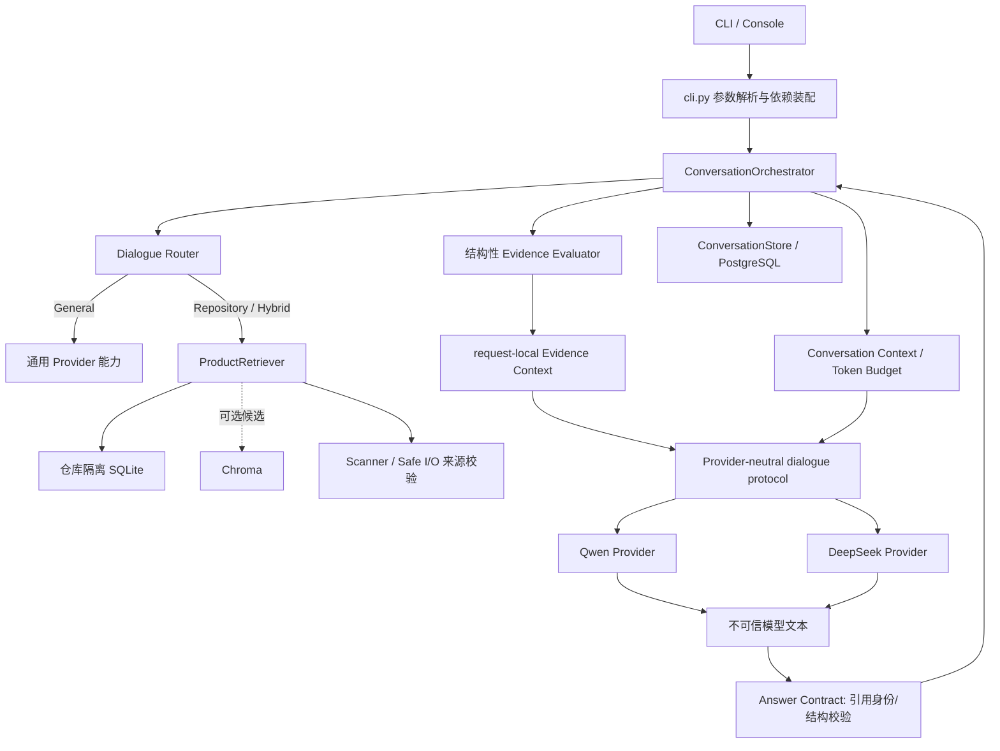

# AgentForge 对话系统依赖图

审计基线：`09bc079ad17b1a2560199eadd679b72c7c779224` (`feature/1.1-core`)。箭头表示运行时/调用方向或静态模块依赖；延迟导入仍算架构依赖，但不意味着模块初始化时一定触发循环。

## 当前整合调用图（2026-11-06 最终复核）

General、Repository、Hybrid、Auto 统一通过 ConversationOrchestrator；Agent 工具循环是显式独立入口，但复用模型预算、Provider、Streaming 生命周期及 PostgreSQL 执行持久化。



`AgentExecutionEngine` no longer imports `AgentLoop`; `ToolCall` and `ToolAuditRecord` are defined at the execution boundary and re-exported by the compatibility facade. The current static scan covered 79 production Python modules and found zero import cycles. For the detailed responsibilities and limits, see `AGENTFORGE_PHASE2_FINAL_INTEGRATION_REPORT_20261106.md`.

## 初始架构审计图（历史快照；编排器和 AgentExecutionEngine 集成前）



当前产品问答的简化序列：

```text
Console -> cli.main -> session load -> optional memory/vector -> ProductRetriever
 -> CLI candidate selection -> build_context -> evidence-role gate -> history prepare
 -> provider.answer -> provider message assembly + plan_context -> model request
 -> request-local citation validation -> Answer Contract -> persist turn -> output
```

这条链由 CLI 直接编排，没有独立 Conversation Orchestrator。`AgentLoop` 是另一个受限工具循环，不能当作 General/Hybrid 对话路由。

## 依赖环解除后的第一阶段检查

第一阶段代码重构后重新扫描 65 个 Python 模块的静态导入：**没有剩余强连通循环**。原仓库身份逻辑现位于 `repository_identity.py`；`IndexStore` 与 Repository Registry 都只依赖该无存储纯函数。Qwen identity 探测现位于 `providers/local_health.py`，不再让 ModelRegistry 导入聊天 Provider。TokenBudget 以最小 `ModelBudgetProfile` 协议读取窗口字段，不再运行时导入 ModelRegistry。

当前主要单向边仍包括 `cli -> ProductRetriever / context / Answer Contract / Store / ConversationStore / MemoryStore / Provider`。CLI 的高耦合和 Provider 依赖 Registry 元数据仍待后续阶段处理。

## 初始基线的静态导入环（已解除）



### 环路解释

- `repositories.py` 的 `open_index_for_repository/open_active_index` 函数内延迟导入 `IndexStore`；`store.py` 顶层导入 `repository_identity`。将 canonical path/ID 放入纯领域模块即可消除 `store -> repositories`。
- `model_registry.py` 的 Qwen identity check 函数内导入 `LlamaServerClient`；Provider 的 `_model_descriptor` 延迟回查 Registry；`token_budget.py` 仅为类型注解而运行时导入 `ModelDescriptor`。将 endpoint health check 放入 Provider adapter/health 模块、让 TokenBudget 使用 `TYPE_CHECKING` 协议引用，可变成单向依赖。

## 目标单向依赖图



`Evidence Evaluator` 仅判断有解释依据的相关性/完整性及其不确定性；它不能把召回分数提升成语义证明。`Answer Validator` 不检索、不更改候选集。Provider 不访问数据库、不做路由、不决定证据是否充分。Orchestrator 负责顺序和错误边界，持久化仍由 Session/Memory/Repository 适配器完成。

## 本轮代码阶段顺序

1. 依赖基线和审计文件（完成）。
2. 解除基础层静态依赖环并添加回归测试。
3. 提取对话请求/结果与 Orchestrator，CLI 保留组合根职责。
4. 在同一调用链接入 General、Repository、Hybrid 和可解释 Auto。
5. 将候选/相关证据/充分性/最终引用显式分层，并保持现有引用安全合同。
6. 统一 Session、Memory、Provider 消息预算和 Streaming 边界；按可验证范围验收。

## 实施后工作树调用图（2026-11-06）

原始图保留为审计基线。当前工作树的一轮调用关系为：



CLI 现在是组合根，`ConversationOrchestrator` 协调单轮用例；它仍通过注入的端口/回调连接现有存储和模型实现。Evidence Evaluator 只给结构性判断，不能证明语义相关或蕴含。Answer Contract 不检索，Provider 不判定引用身份。Auto 是词法规则。该图描述当前已实现路径，不表示统一 Session Manager、语义 Planner 或 Streaming Manager 已交付。

## Phase 2 current worktree graph (2026-11-06; supersedes the older implementation snapshot)

CLI / Console → composition root → ConversationOrchestrator
→ Auto/Hybrid only: selected Provider → LLMPlanner → strict plan schema → Dialogue Router
→ General path, or bounded repository task queries → ProductRetriever
→ candidate selection and source snapshot check → structural Evidence Evaluator
→ request-local Evidence IDs and model-aware ContextBudgetManager
→ Qwen / DeepSeek adapter → untrusted response
→ Answer Contract identity/role/structure validation
→ SessionService commit of completed turns → PostgreSQL adapter → CLI result.

The static AST scan parsed 77 production modules with no syntax errors or import cycles. It does not establish runtime dependency direction. Remaining coupling and incomplete components are listed in DIALOGUE_SYSTEM_FINAL_REPORT_20261106.md.
